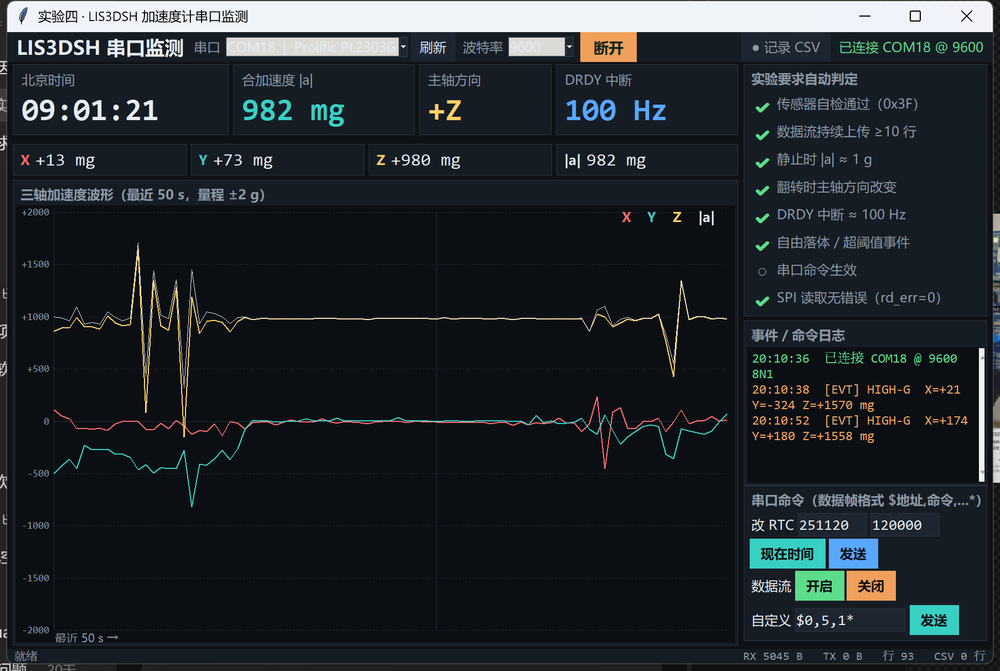

# 实验四（综合实验）：MEMS 数字加速度计 LIS3DSH 的使用

> 课程：微处理器结构与嵌入式系统设计
> 硬件：STM32F407G-DISC1（STM32F407VGT6，LQFP100，8 MHz 晶振，板载 LIS3DSH）
> 工具：STM32CubeMX 6.15.0 + Keil MDK 5.29（ARMCC 5.06）+ STM32Cube FW_F4 V1.28.0
> 许可：[MIT License](LICENSE)

本工程完成综合实验的要求：**用 ARM 通过 SPI1 控制板载 LIS3DSH 三轴加速度计，
采集加速度并换算成 mg，按 5 Hz 通过 USART2 上传到计算机**；并在此基础上加入了
**INT1 数据就绪中断**、**自由落体 / 超阈值事件检测**、**串口命令**（改 RTC 时间、开关数据流）
和 **RTC 时间戳**，可直接用于实验报告的测试与截图。

> **简化版说明**：本工程按"功能保留、实现最简"重写——加速度计驱动直接写在 `main.c` 里，
> 串口用阻塞发送，RTC 直接读，中断里只置标志。**用户代码只有一个文件**（`Core/Src/main.c`），
> 共 10 个函数；Code 12.6 KB。实验要求的自检、100 Hz 采样、INT1 中断、串口上传、
> 事件提示、串口命令全部保留。

工程已用 Keil 命令行完整编译：**0 Error / 0 Warning**，生成
`MDK-ARM/Exp4_LIS3DSH_MEMS/Exp4_LIS3DSH_MEMS.hex` / `.bin`。
（本次构建环境未连接开发板，上板测试请按第六节步骤执行。）

---

## 一、实验要求与实现对照

| 任务书要求 | 实现位置 | 实现方式 |
|---|---|---|
| 利用 ARM 控制板载 MEMS 数字加速度计 LIS3DSH | `main.c` → `LIS3DSH_Init()` | SPI1（PA5/PA6/PA7）+ 软件片选 PE3；先读 `WHO_AM_I` 验证链路，再写控制寄存器 |
| 采集加速度数据 | `main.c` → `LIS3DSH_GetXYZ()` | 逐字节读 `OUT_X_L..OUT_Z_H` 共 6 字节，拼成 3 个 16 位有符号数并换算成 mg |
| 通过串口上传至计算机 | `main.c` 主循环 + `fputc()` | USART2 9600-8-N-1，阻塞发送，每 200 ms 输出一行（时间 + 三轴 mg） |
| INT1 数据就绪中断 | `main.c` → `HAL_GPIO_EXTI_Callback()` | INT1(PE0)=DRDY 上升沿，中断里只置标志；主循环取标志读数据，20 ms 无中断则轮询兜底 |
| 数据上传结果可观察、可核对 | `main.c` → 数据行 + `[STAT]` 统计 | 每行带 RTC 时间戳与三轴 mg；每 10 s 报 DRDY/接收/错误计数 |

附加（超出最低要求、便于报告展示）：

- 传感器 **ID 自检**：`WHO_AM_I` 不是 `0x3F` 时每秒重试并打印原因，接线恢复后自动继续；
- **INT1 失联兜底**：20 ms 没有 DRDY 中断就轮询采样，LD6 指示中断链路是否正常；
- **事件检测**：合加速度 < 300 mg 连续 5 点判自由落体，单轴 > 1.5 g 判超阈值，LD5 点亮 300 ms；
- **串口命令**：`$0,1,YYMMDD,HHMMSS*` 改 RTC，`$0,5,0*` / `$0,5,1*` 关/开数据流；
- **按键**：B1 暂停/恢复数据流（因 EXTI0 已被 INT1 占用，按键改为轮询消抖）。

---

## 二、硬件连接（板载，无需外部接线）

| 信号 | STM32 引脚 | 外设配置 | 说明 |
|---|---|---|---|
| SPI1_SCK | PA5 | AF5 推挽，Very High | LIS3DSH SPC |
| SPI1_MISO | PA6 | AF5 推挽 | LIS3DSH SDO |
| SPI1_MOSI | PA7 | AF5 推挽 | LIS3DSH SDI |
| LIS3DSH_CS | **PE3** | GPIO 输出，上电置高 | 片选，低电平有效 |
| LIS3DSH_INT1 | **PE0** | EXTI0 上升沿，下拉 | 数据就绪（DRDY）中断 |
| LIS3DSH_INT2 | **PE1** | EXTI1 上升沿，下拉 | 状态机事件输入（预留） |
| USART2_TX | PA2 | AF7 | 接 USB-TTL 模块 RXD |
| USART2_RX | PA3 | AF7 | 接 USB-TTL 模块 TXD |
| LD3 / LD4 / LD5 / LD6 | PD13 / PD12 / PD14 / PD15 | 推挽输出 | 状态指示 |
| B1 | PA0 | 输入下拉，**轮询** | 暂停/恢复数据流 |

> ⚠️ **EXTI0 只能二选一**：PA0(B1) 和 PE0(LIS3DSH INT1) 共用 EXTI0 线。
> 本实验按任务书要求把 PE0 用于传感器 INT1，因此 B1 不能再配外部中断，改为 20 ms 消抖轮询。

LED 含义：

| LED | 含义 |
|---|---|
| LD3（橙） | 数据流已开启（初始化成功且未暂停） |
| LD4（绿） | RTC 秒心跳，1 Hz 翻转 |
| LD5（红） | 自由落体/超阈值事件，点亮 300 ms；传感器初始化失败时慢闪 |
| LD6（蓝） | INT1 中断链路正常（1 s 内有 DRDY 中断） |

串口线只接 **RXD、TXD、GND** 三根（红线不接）：模块 RXD→PA2，TXD→PA3，GND→GND。

---

## 三、CubeMX 关键配置

| 项目 | 设置 |
|---|---|
| MCU | STM32F407VGTx（STM32F407G-DISC1） |
| 时钟 | HSE 8 MHz，PLL M=8/N=336/P=2/Q=7 → **SYSCLK 168 MHz**，APB1/4=42 MHz，APB2/2=84 MHz |
| SPI1 | Master，Full-Duplex，8 bit，MSB first，**Mode 0**（CPOL=Low，CPHA=1Edge），NSS 软件，**预分频 16 → 5.25 MHz**（器件上限 10 MHz） |
| USART2 | 9600 bps，8 数据位，1 停止位，无校验 |
| RTC | LSI 32 kHz，异步 127 / 同步 249，1 Hz 唤醒中断 |
| EXTI | PE0→EXTI0（抢占 2），PE1→EXTI1（抢占 3） |
| NVIC | USART2=1，RTC_WKUP=0（用户代码里使能） |
| 工程 | MDK-ARM V5，栈 0x800，堆 0x200 |

`Exp4_LIS3DSH_MEMS.ioc` 由 CubeMX 6.15 生成/校验，可直接在 CubeMX 中打开、修改、重新生成代码。

### LIS3DSH 寄存器配置（±2 g）

| 寄存器 | 地址 | 写入值 | 含义 |
|---|---|---|---|
| `CTRL_REG5` | 0x24 | `0x00` | 量程 ±2 g，抗混叠滤波 800 Hz，4 线 SPI |
| `CTRL_REG4` | 0x20 | `0x6F` | ODR=100 Hz（0110），BDU 锁存，X/Y/Z 三轴使能 |
| `CTRL_REG3` | 0x23 | `0xF8` | DRDY→INT1，高有效，脉冲方式，INT1/INT2 引脚使能 |
| 读 `OUT_X`/`OUT_Y`/`OUT_Z` | 0x28~0x2D | — | 读命令字节为 `0xA8~0xAD`（地址 \| 0x80），逐字节读 6 次 |

灵敏度：±2 g 时 **0.06 mg/LSB**，`mg = raw × 6 / 100`（整数四舍五入）。
SPI 帧格式：地址为 7 位（0x00~0x7F），bit7 = 1 读 / 0 写；多字节地址自增由 CTRL_REG6 的 ADD_INC 控制，本工程逐字节读取，不依赖该位。

---

## 四、目录结构

```
Exp4_LIS3DSH_MEMS/
├─ Exp4_LIS3DSH_MEMS.ioc        CubeMX 工程（SPI1 / USART2 / RTC / EXTI0 / EXTI1）
├─ Core/
│  ├─ Inc/  main.h  gpio.h  spi.h  usart.h  rtc.h
│  │        stm32f4xx_it.h  stm32f4xx_hal_conf.h
│  └─ Src/  main.c               ★ 全部用户代码：驱动 + 采样 + 事件 + 命令
│           spi.c  usart.c  rtc.c  gpio.c          ← CubeMX 生成
│           stm32f4xx_it.c  stm32f4xx_hal_msp.c  system_stm32f4xx.c
├─ Drivers/                      CMSIS + STM32F4xx HAL（CubeF4 V1.28.0）
├─ MDK-ARM/
│  ├─ Exp4_LIS3DSH_MEMS.uvprojx
│  └─ Exp4_LIS3DSH_MEMS/         .axf / .hex / .bin / .map
├─ tools/serial_monitor.py       配套串口监测软件（图形界面）
├─ tools/serial_log.py           命令行 CSV 记录脚本（可选）
└─ docs/工程详解.md               设计说明与易错点
```

---

## 五、编译与烧录

1. Keil 打开 `MDK-ARM/Exp4_LIS3DSH_MEMS.uvprojx`，`F7` 编译（当前：**0 Error / 0 Warning**，
   Code=12 666 B，RO=738 B，RW=40 B，ZI=2 880 B）。
2. 烧录三选一：
   - 把 `MDK-ARM/Exp4_LIS3DSH_MEMS/Exp4_LIS3DSH_MEMS.bin` 拖到 `DIS_F407VG` 盘（DAPLink）；
   - Keil `F8`（Options→Debug 选 ST-Link Debugger，Port: SW）；
   - STM32CubeProgrammer。
3. 串口：USB-TTL 9600-8-N-1，接 PA2/PA3/GND；上电后应看到横幅与数据行。

> **重新生成代码注意**：所有用户代码都在 `main.c` 的 `USER CODE` 区里，
> CubeMX 重新生成时会原样保留，不需要手动改工程文件。

---

## 六、上电后的串口输出

```
** Experiment 4: LIS3DSH accelerometer **
SPI1: PA5/PA6/PA7  CS=PE3  INT1=PE0
USART2: 9600-8-N-1, data 5 Hz
[OK] LIS3DSH ready: 100 Hz, +-2 g

09:00:01  X=-0007 Y=-0005 Z=+0980 mg
09:00:01  X=-0006 Y=-0005 Z=+0981 mg
09:00:02  X=-0005 Y=-0004 Z=+0979 mg
...
[STAT] drdy=1031 rx=0 err=0
```

- 静止平放：`Z ≈ +1000 mg`，`X/Y ≈ 0`；
- 翻转板子：对应轴接近 ±1000 mg，符号随方向改变（监测软件会标出主轴）；
- 自由落体：合加速度跌到 300 mg 以下 → `[EVT] FREE-FALL`；
- 用力晃动（>1.5 g）→ `[EVT] HIGH-G X=... Y=... Z=...`；
- 每 10 s 的 `[STAT] drdy=` 增量应约为 100/s（ODR=100 Hz 且 INT1 正常）。

串口命令示例：

```
发送: $0,1,251120,153000*
回显: [RX] $0,1,251120,153000*
      [RTC] updated -> 2025-11-20 15:30:00
      ...下一秒数据行时间戳变为 15:30:0x

发送: $0,5,0*        → [CMD] stream OFF（LD3 灭，每秒只打印一行 RTC 时间）
发送: $0,5,1*        → [CMD] stream ON
```

### 数据记录（可选）

上板测试时可用 `tools/serial_log.py` 把数据行直接存成 CSV（需要 pyserial）：

```bat
python tools/serial_log.py --list                 :: 列出串口
python tools/serial_log.py --port COM5 --out exp4_data.csv
```

CSV 列为 `time_rtc, x_mg, y_mg, z_mg, mag_mg, axis`，可直接导入 Excel/Matlab 画曲线。
不接硬件也可用 `python tools/serial_log.py --selftest` 验证解析规则。

---

## 七、上板测试步骤（对照实验报告"测试过程及结果"）

| # | 操作 | 预期现象 | 判据 |
|---|---|---|---|
| 1 | 上电，串口助手 9600-8-N-1 打开 | 横幅完整，`WHO_AM_I = 0x3F OK` | SPI 链路与芯片工作正常 |
| 2 | 观察静止数据行 | `Z ≈ +1000 mg`，`|a| ≈ 1000 mg`，标记 `+Z` | 三轴换算正确 |
| 3 | 把板子翻面/立起 | 主轴标记变化，对应轴 ±1000 mg 左右 | 轴向与符号正确 |
| 4 | 看 LD6 | 常亮 | INT1(DRDY) 中断链路正常 |
| 5 | 看每 10 s 的 `[STAT]` | `drdy` 每秒增加约 100 | ODR=100 Hz 与中断计数一致 |
| 6 | 松手让板子自由下落（落在软垫上） | `[EVT] FREE-FALL`，LD5 闪 300 ms | 事件检测有效 |
| 7 | 快速晃动板子 | `[EVT] HIGH-G` | 阈值检测有效 |
| 8 | 发送 `$0,1,...*` | 回显 + `[RTC] updated`，随后数据行时间戳改变 | 串口帧解析与 RTC 更新正确 |
| 9 | 发送 `$0,5,0*` / `$0,5,1*` | `[CMD] stream OFF/ON`，LD3 灭/亮 | 命令控制有效 |
| 10 | 按 B1 | `[KEY] B1 -> stream OFF/ON` | 按键轮询有效 |

若第 1 步失败：先查 PE3 片选、PA5/6/7 是否被别的功能占用、杜邦线/板子是否虚焊；
串口若乱码：确认 9600-8-N-1、TX/RX 交叉、共地（PE4 已置低，可作地参考）。

---

## 八、常见问题

| 现象 | 原因 / 处理 |
|---|---|
| `WHO_AM_I` 读到 0x00 或 0xFF | MISO 未接通、CS 未拉到 PE3、SPI 模式/引脚复用错误 |
| ID 正确但没有数据行 | 传感器初始化失败（回读 `CTRL_REG4` 不等于 0x67）；看串口提示 |
| LD6 不亮但数据正常 | INT1 没接到 PE0 或中断未触发；程序已自动退化为 20 ms 轮询，功能不受影响 |
| 数据行比 5 Hz 慢 | 9600 波特率下 FIFO 满；确认没有同时打印大量调试信息 |
| 时间戳一直是 00:00:00 | RTC 秒中断未开（`RTC_WKUP_IRQn` 在 `rtc.c` 用户区使能）；检查 LSI 是否开启 |
| 数据全为 0 | 传感器还在 Power-Down（`CTRL_REG4` ODR 位没写进去），看回读校验提示 |

---

## 九、配套串口监测软件

`tools/serial_monitor.py` 是专门为本实验写的图形化监测软件（纯 Python + tkinter，
除 pyserial 外无第三方依赖），桌面已放置快捷方式「**实验四串口监测**」，双击即可运行。



功能：

| 区域 | 内容 |
|---|---|
| 状态卡片 | RTC 时间、合加速度 \|a\|、主轴方向、DRDY 中断频率 |
| 实时波形 | X/Y/Z + \|a\| 四线滚动显示（最近 50 s，±2 g），事件处可直接看到冲击 |
| 实验要求自动判定 | 8 项要求随数据自动打勾：自检、数据流、静止 1 g、翻转方向、100 Hz、事件、命令、无错 |
| 事件日志 | FREE-FALL / HIGH-G / 改时间 / 命令回显，按类型着色 |
| 命令面板 | 一键改 RTC（`$0,1,...*`）、开关数据流（`$0,5,x*`）、自定义帧 |
| CSV 记录 | 点「记录 CSV」即开始，文件在程序目录 `logs/exp4_时间.csv` |

使用：

```bat
python tools/serial_monitor.py            :: 自动选 USB-TTL 口并连接
python tools/serial_monitor.py -p COM18   :: 指定串口
python tools/serial_monitor.py --demo     :: 无硬件演示
```

- 自动选口时会优先选 Prolific / CH340 / CP210x，跳过 ST-Link 虚拟串口（本板 VCP 未接 PA2/PA3）；
- 桌面文件夹里还有「调试启动-显示控制台.bat」，出问题时用它能看到报错信息；
- 软件与 `tools/serial_log.py` 共用同一套数据行格式，二者可任选其一。

---

## 十、与实验一~三的衔接

本工程把前几个实验的公共部分（168 MHz 时钟树、USART2、RTC、GPIO、EXTI）保留在
CubeMX 配置里，用户代码只集中在 `main.c`：SPI 读写、自检、采样、事件、命令各一小段，
适合逐段讲解和答辩。

---

## 十一、许可

本项目采用 **MIT License**，详见 [LICENSE](LICENSE)。
`Drivers/` 下的 CMSIS 与 STM32F4xx HAL 驱动由 ARM / STMicroelectronics 提供，
遵循其原始许可，详见 [THIRD_PARTY_NOTICES.md](THIRD_PARTY_NOTICES.md)。
